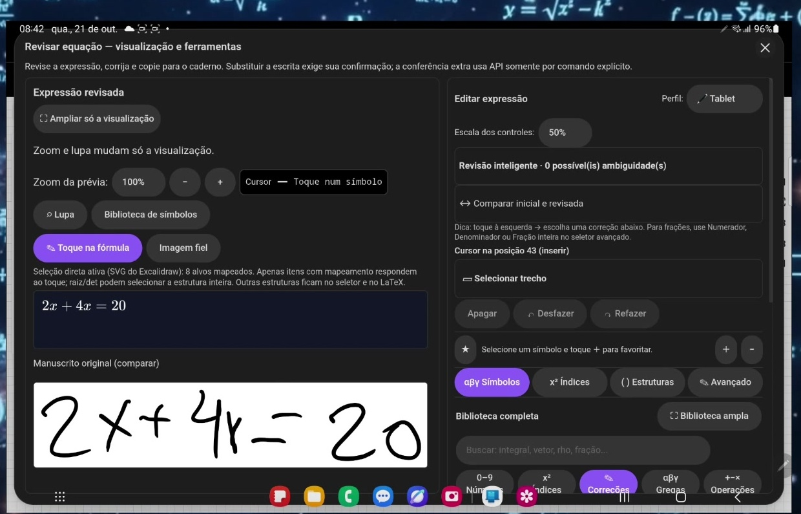
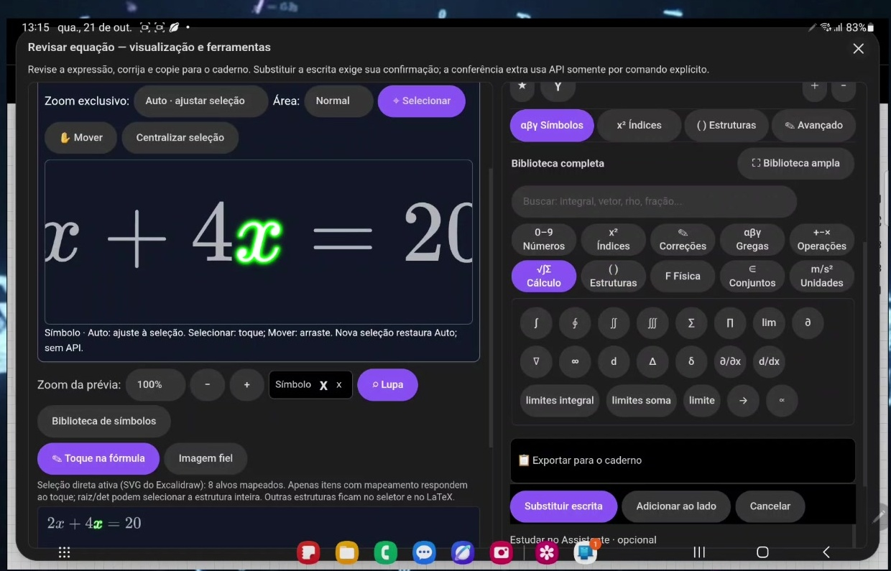
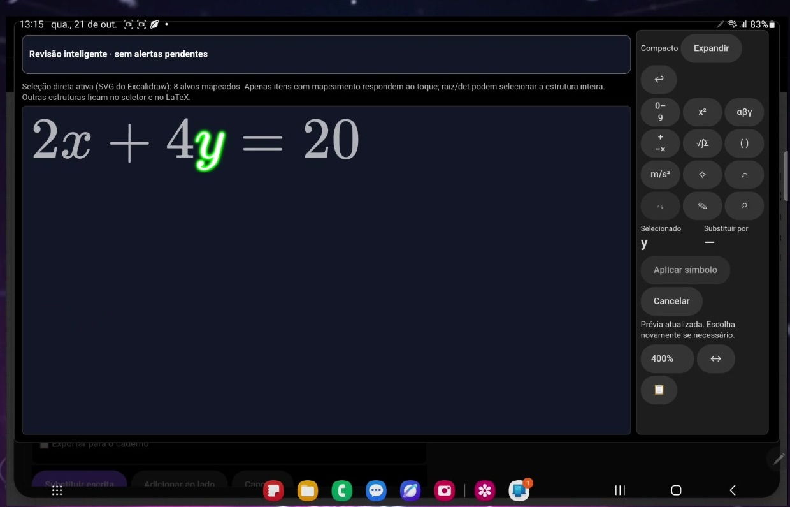
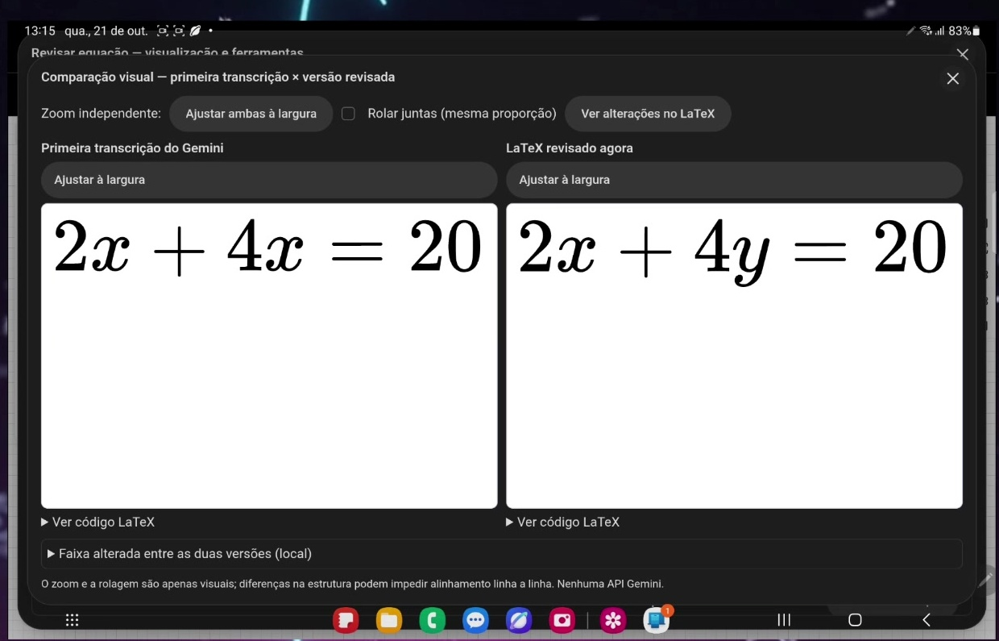
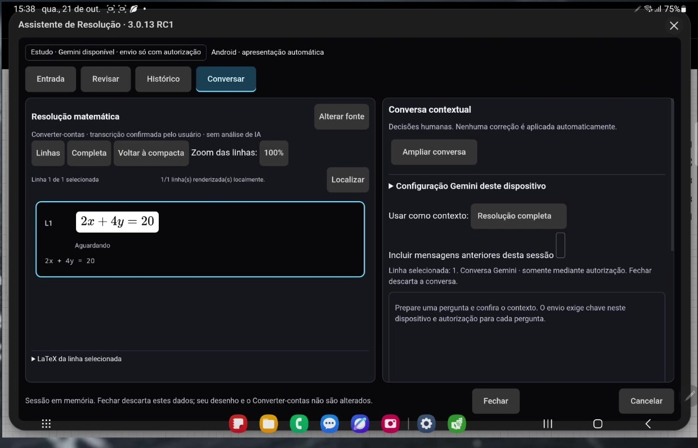
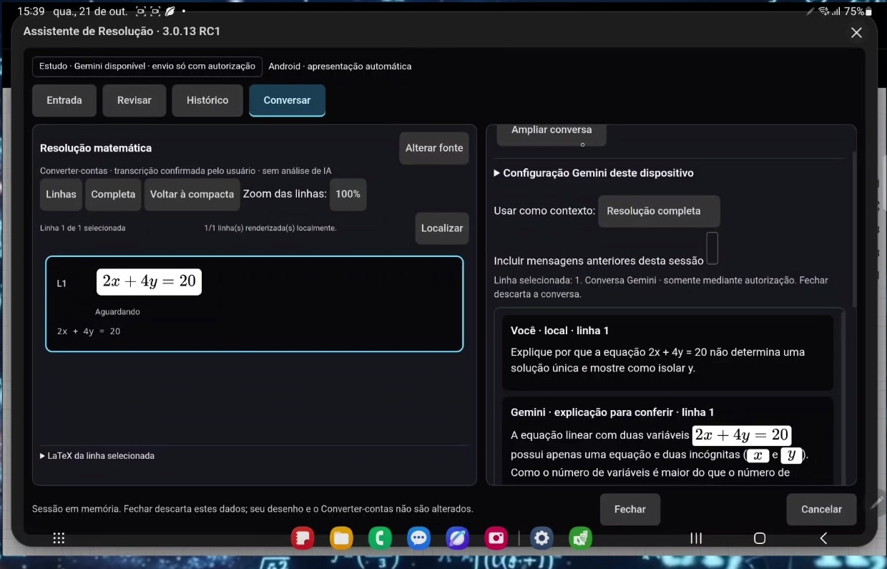

# Guia de funções para estudantes

Guia ilustrado do pacote documentado Converter-contas **2.9.21 RC2** + Assistente **3.0.13 RC1** · 21/10/2026 · documentação, não instalador.

As imagens são quadros reais do vídeo fornecido. Os detalhes são recortes, sem redesenho ou alteração da interface. O Assistente aparece identificado como **3.0.13 RC1** nos quadros. As imagens ilustram o funcionamento observado, mas não provam por si só a identidade binária do instalador: confira sempre a Release e os hashes correspondentes.

## Confira o reconhecimento

O manuscrito mostra 2x + 4y = 20, mas a primeira transcrição aparece como 2x + 4x = 20. Compare com o original antes de aceitar. Reconhecer não garante acerto.

Fonte: vídeo “Converter-contas — Comercial Oficial.mp4”, 00:18. Recorte da janela; o quadro completo está em capturas/t18.jpg.

## Selecione e corrija um símbolo

Toque no símbolo mapeado da fórmula. A lupa amplia a seleção; a biblioteca reúne números, índices, letras gregas, operações e estruturas. Escolha a substituição e confira a prévia. A revisão e o zoom mostrados são locais.

Fonte: vídeo “Converter-contas — Comercial Oficial.mp4”, 00:32. Recorte da janela; o quadro completo está em capturas/t32.jpg.

## Amplie para revisar

A visualização ampliada deixa a fórmula e os controles de seleção maiores. O quadro mostra y selecionado. Zoom não altera o valor da expressão. Se o toque não selecionar a estrutura desejada, use o seletor disponível ou a edição LaTeX.

Fonte: vídeo “Converter-contas — Comercial Oficial.mp4”, 00:43. Recorte da janela; o quadro completo está em capturas/t43.jpg.

## Compare antes de aplicar

A comparação coloca a primeira transcrição ao lado da versão revisada: x foi trocado por y. Confirme cada alteração. No fluxo principal, escolha Substituir escrita, Adicionar ao lado ou Exportar para o caderno conforme seu objetivo; substituir exige confirmação.

Fonte: vídeo “Converter-contas — Comercial Oficial.mp4”, 00:51. Recorte da janela; o quadro completo está em capturas/t51.jpg.

## Leve a expressão ao Assistente

A transferência é opcional e depende da sua confirmação. No Assistente, confira a fonte e a linha carregada. As abas Entrada, Revisar, Histórico e Conversar organizam o trabalho. Não confunda Histórico com garantia de conversa persistida: a tela avisa que fechar descarta a sessão.

Fonte: vídeo “Converter-contas — Comercial Oficial.mp4”, 01:08. Recorte da janela; o quadro completo está em capturas/t68.jpg.

## Pergunte com contexto

Escolha a linha ou a resolução completa e revise a pergunta. Mensagens anteriores são opcionais. O envio à Gemini exige elegibilidade e autorização; não é uma função local. Confira a explicação: a IA pode errar e não aplica correções automaticamente.

Fonte: vídeo “Converter-contas — Comercial Oficial.mp4”, 01:30. Recorte da janela; o quadro completo está em capturas/t90.jpg.

## Uso sem API

Para revisar localmente uma expressão já carregada, use seleção, lupa, biblioteca e comparação. No Assistente, a colagem de LaTeX é uma rota prevista na documentação local. O reconhecimento por Gemini e a conversa com Gemini dependem de serviço externo: não anuncie reconhecimento offline. Nenhuma chamada à API foi feita para este kit.

## Público e privacidade

A Gemini API exige 18 anos e proíbe clientes dirigidos ou provavelmente acessados por menores. Também restringe finalidade e regiões. Não basta uma caixa “sou maior” ou uma chave pessoal para presumir conformidade. O lançamento geral para estudantes com IA depende de resolver essa adequação. Serviços gratuitos podem envolver uso dos dados para melhoria e revisão humana; não envie dados pessoais ou confidenciais. A IA não substitui sua conferência matemática.

## Precisa de ajuda?

Consulte a página oficial do repositório para verificar se há canal de feedback publicado. Não compartilhe chave da API, arquivos pessoais ou informações confidenciais.
